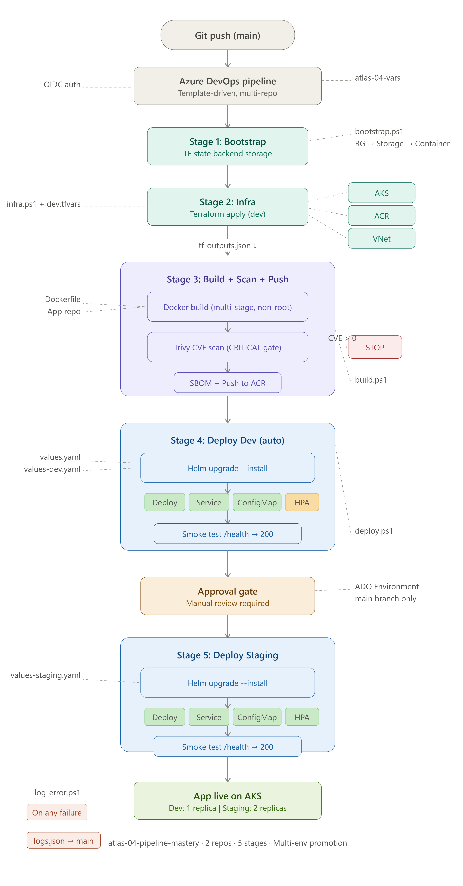
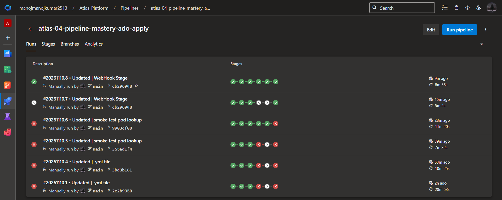
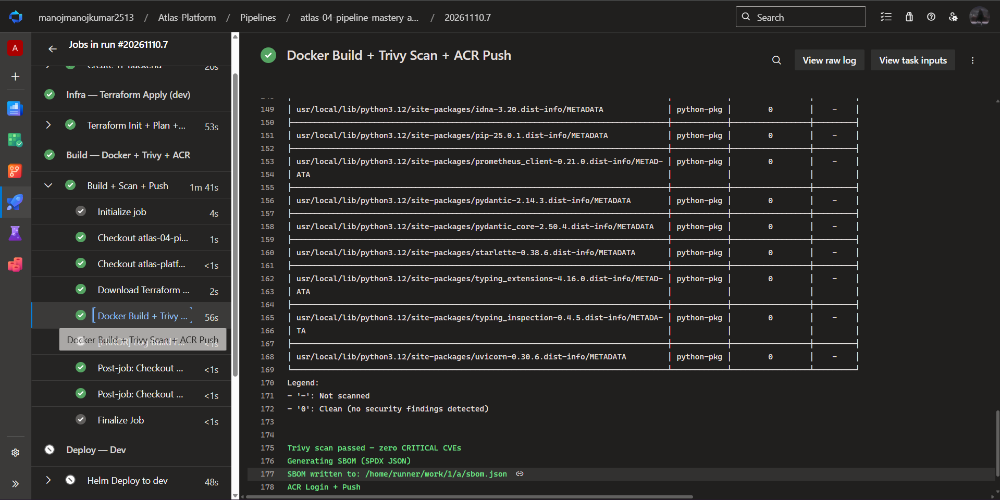
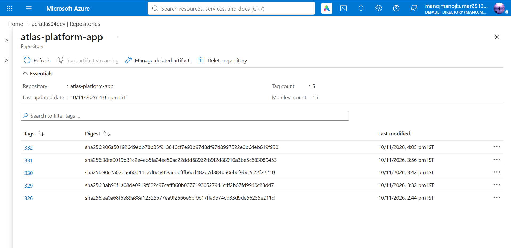
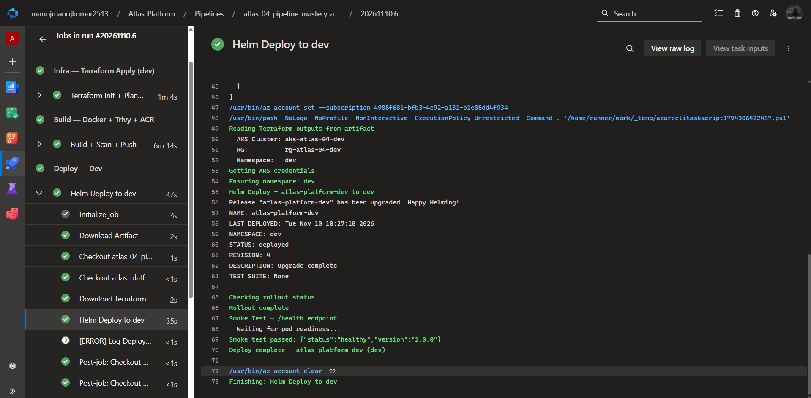
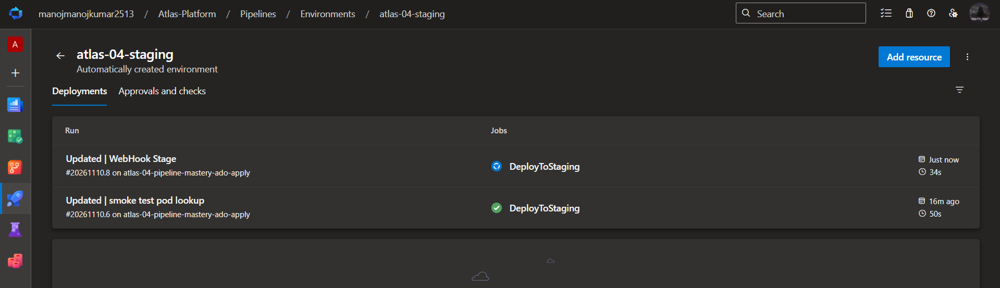
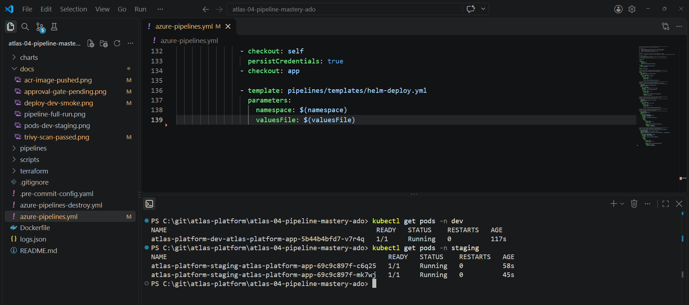

# Atlas-04: CI/CD Pipeline Mastery with Azure DevOps

> **Project 4 of 11** in the [Atlas Platform Portfolio](https://github.com/manoj-2606) — building production-grade Azure infrastructure, one project per day.

## What This Project Demonstrates

This project is about **pipeline architecture**, not just CI/CD. While P3 proved a flat pipeline can build and deploy, P4 proves you can build **reusable, parameterized pipeline components** that scale across teams and environments.

**The pipeline IS the project.** Every concept here — YAML templates, variable templates, pipeline artifacts, multi-environment promotion, branch-based conditions — is what separates a junior "I wrote a pipeline" from a senior "I architect pipeline systems."

## What Makes P4 Different from P1–P3

| Concept | P1 | P2 | P3 | P4 |
|---|---|---|---|---|
| Execution pattern | Inline Bash + PowerShell | Bash script files | PowerShell .ps1 engines | **YAML templates + DRY helpers** |
| Pipeline structure | Flat, 4 stages | Flat, 5 stages | Flat, 4 stages | **Templated, 5 stages** |
| Environments | Single (dev) | None (ACR only) | Single (dev) | **Multi-env: dev → staging** |
| Variable management | Variable group only | Variable group only | Variable group only | **Variable templates per env** |
| Terraform outputs | Re-init per stage | N/A | Re-init per stage | **Pipeline artifacts** |
| Branch strategy | All pushes deploy | All pushes deploy | All pushes deploy | **Branch conditions** |
| Shared code | None | None | Copy-paste | **DRY helper modules** |
| Approval gates | None | None | None | **ADO Environment gates** |

## Architecture



### Pipeline Flow

```
feature/* branch push:
  Bootstrap → Infra(dev) → Build → Deploy(dev)

main branch push:
  Bootstrap → Infra(dev) → Build → Deploy(dev) → [Approval Gate] → Deploy(staging)
```

### Infrastructure

- **One AKS cluster** provisioned via Terraform (dev environment)
- **Two namespaces** — `dev` and `staging` — on the same cluster
- **Staging uses same infra as dev** (cost optimization for portfolio demo)
- In production: staging would be a separate cluster with its own Terraform apply

### Pipeline Artifacts Pattern

```
┌─────────────┐     tf-outputs.json      ┌──────────────┐
│  Infra Stage │ ──── PublishArtifact ───→ │   Artifact   │
│  (TF Apply)  │                          │   Storage    │
└─────────────┘                           └──────┬───────┘
                                                 │
                              ┌──────────────────┼──────────────────┐
                              │ DownloadArtifact  │ DownloadArtifact │
                              ▼                   ▼                  │
                      ┌──────────────┐    ┌──────────────┐          │
                      │  Build Stage │    │ Deploy Stage  │          │
                      │  (reads ACR) │    │ (reads AKS)   │         │
                      └──────────────┘    └──────────────┘
```

**Why this matters:** In P3, both `build.ps1` and `deploy.ps1` ran `terraform init` just to read outputs — adding ~30s and an unnecessary state lock per call. P4 publishes outputs once and downstream stages read a JSON file. Zero redundant init calls.

## Core Concepts Explained

### YAML Templates (pipelines/templates/)

A YAML template is a **reusable block of pipeline steps** with typed parameters. Instead of copy-pasting steps across pipelines, you define them once and import them.

```yaml
# Template definition (pipelines/templates/helm-deploy.yml)
parameters:
  - name: namespace
    type: string
  - name: valuesFile
    type: string

steps:
  - task: AzureCLI@2
    inputs:
      scriptPath: $(scriptsDir)/deploy.ps1
      arguments: -Namespace "${{ parameters.namespace }}" ...
```

```yaml
# Template invocation (azure-pipelines.yml)
- template: pipelines/templates/helm-deploy.yml
  parameters:
    namespace: dev
    valuesFile: values-dev.yaml
```

**5 templates in this project:**

| Template | Purpose |
|---|---|
| `bootstrap.yml` | Create Terraform backend storage (idempotent) |
| `terraform-apply.yml` | Init + Plan + Apply + Publish outputs artifact |
| `build-scan-push.yml` | Docker build + Trivy scan + SBOM + ACR push |
| `helm-deploy.yml` | Helm upgrade/install + rollout check + smoke test |
| `terraform-destroy.yml` | Destroy infra + delete backend RG |

### Variable Templates (pipelines/variables/)

Instead of stuffing all variables into one group, P4 uses **per-environment YAML variable files**.

- `common.yml` — loaded at pipeline level (paths, service connection, backend config)
- `dev.yml` — loaded per-stage when targeting dev (namespace, tfvars file, values file)
- `staging.yml` — loaded per-stage when targeting staging

**Why this matters:** Adding a new environment (e.g., `prod`) means creating one file (`prod.yml`) and one new stage in the orchestrator. No variable group changes. No script changes. No template changes.

### DRY Helper Modules (scripts/helpers/)

Repeated code from P3 extracted into reusable PowerShell functions:

| Helper | What It Eliminates | Lines Saved Per Script |
|---|---|---|
| `Setup-Terraform.ps1` | Terraform install + OIDC env vars | ~22 lines |
| `Write-ErrorContext.ps1` | error-context.json creation | ~8 lines |
| `Get-TerraformOutputs.ps1` | Terraform init for reading outputs (fallback) | ~15 lines |

### Branch-Based Conditions

```yaml
# DeployStaging stage
condition: and(succeeded(), eq(variables['Build.SourceBranch'], 'refs/heads/main'))
```

- `feature/*` branches → deploy to dev only
- `main` branch → deploy to dev + staging (with approval gate)

### Multi-Environment Promotion

```
Dev (auto)                    Staging (manual approval)
┌─────────────────────┐      ┌─────────────────────┐
│ Namespace: dev      │      │ Namespace: staging   │
│ Values: values-dev  │ ───→ │ Values: values-stg   │
│ Replicas: 1         │      │ Replicas: 2          │
│ HPA: disabled       │      │ HPA: enabled         │
│ Log level: debug    │      │ Log level: info       │
└─────────────────────┘      └─────────────────────┘
```

Approval gates are configured in **ADO Environments** (Project Settings → Environments → atlas-04-staging → Approvals and checks).

## Repo Structure

```
atlas-04-pipeline-mastery-ado/
├── terraform/
│   ├── main.tf                          # Calls atlas-infra-base module
│   ├── variables.tf                     # No defaults for version-sensitive values
│   ├── outputs.tf                       # Published as pipeline artifact
│   └── environments/
│       ├── dev.tfvars                   # Dev config (used by pipeline)
│       └── staging.tfvars               # Pattern file (staging = Helm namespace)
├── Dockerfile                           # Multi-stage, non-root, < 100MB
├── charts/
│   └── atlas-platform/
│       ├── Chart.yaml
│       ├── values.yaml                  # Production defaults (strictest)
│       ├── values-dev.yaml              # Dev overrides (relaxed)
│       ├── values-staging.yaml          # Staging overrides (near-prod)
│       └── templates/
│           ├── _helpers.tpl
│           ├── deployment.yaml
│           ├── service.yaml
│           ├── configmap.yaml
│           └── hpa.yaml
├── pipelines/
│   ├── templates/                       # ★ Reusable YAML templates
│   │   ├── bootstrap.yml
│   │   ├── terraform-apply.yml
│   │   ├── terraform-destroy.yml
│   │   ├── build-scan-push.yml
│   │   └── helm-deploy.yml
│   └── variables/                       # ★ Per-environment variable templates
│       ├── common.yml
│       ├── dev.yml
│       └── staging.yml
├── scripts/
│   ├── helpers/                         # ★ DRY PowerShell modules
│   │   ├── Setup-Terraform.ps1
│   │   ├── Get-TerraformOutputs.ps1
│   │   └── Write-ErrorContext.ps1
│   ├── bootstrap.ps1
│   ├── infra.ps1
│   ├── build.ps1
│   ├── deploy.ps1
│   ├── destroy.ps1
│   └── log-error.ps1
├── docs/                                # Screenshots (see Evidence section)
├── azure-pipelines.yml                  # ★ Main deploy orchestrator
├── azure-pipelines-destroy.yml          # ★ Destroy orchestrator
├── .pre-commit-config.yaml              # gitleaks + terraform_fmt + terraform_validate
├── .gitignore
├── logs.json                            # Auto-populated by pipeline on failure
└── README.md
```

## How to Run

### Prerequisites

1. **Azure DevOps project** `Atlas-Platform` with service connection `MI-ADO-API` (OIDC)
2. **ADO repo** `atlas-04-pipeline-mastery-ado` under Atlas-Platform project
3. **ADO repo** `atlas-platform-app` (the standard workload app)
4. **Variable group** `atlas-04-vars` with `ARM_CLIENT_ID`, `ARM_TENANT_ID`, `ARM_SUBSCRIPTION_ID`
5. **Environments** created in ADO:
   - `atlas-04-dev` — no approval gate
   - `atlas-04-staging` — manual approval gate configured
   - `atlas-04-destroy` — manual approval gate configured
6. **Repo permissions** set for both Build Service identities:
   - Contribute: Allow
   - Bypass policies when pushing: Allow

### Verify K8s Version

```bash
az aks get-versions --location centralindia --output table
```

Update `terraform/environments/dev.tfvars` with the latest stable version.

### Deploy

Push to `main` branch → pipeline triggers automatically.

```bash
git add -A
git commit -m "feat: P4 pipeline mastery — YAML templates + multi-env promotion"
git push origin main
```

Pipeline stages: Bootstrap → Infra → Build → Deploy(dev) → Approval → Deploy(staging)

### Verify

```bash
# Pods running in both namespaces
kubectl get pods -n dev
kubectl get pods -n staging

# Environment-specific config
kubectl get configmap -n dev -o yaml | Select-String "APP_ENV"      # dev
kubectl get configmap -n staging -o yaml | Select-String "APP_ENV"  # staging

# HPA only in staging
kubectl get hpa -n dev        # No resources found
kubectl get hpa -n staging    # atlas-platform HPA active

# Replica count
kubectl get deployment -n dev -o wide      # 1 replica
kubectl get deployment -n staging -o wide   # 2 replicas
```

### Destroy

Run the `azure-pipelines-destroy.yml` pipeline manually from ADO.

Order: Terraform destroy (needs state) → Delete backend RG (removes state storage)

### State Lock Recovery (if needed)

```bash
az storage blob lease break \
  --blob-name atlas-04.tfstate \
  --container-name tfstate \
  --account-name atlastfstate2606
```

## Cost

| Resource | Cost | Duration |
|---|---|---|
| AKS control plane | Free | — |
| 1× Standard_B2s node | ~$0.04/hr | ~4 hrs |
| ACR Basic | ~$0.17/day | 1 day |
| VNet / NSG | Free | — |
| **Total** | **~₹50 (~$0.60)** | **1 day** |

### FinOps Practices

- Every resource tagged: `project`, `environment`, `team`, `cost-center`, `created-by`, `managed-by`, `destroy-by`
- Right-sized: Standard_B2s (not D2s), Basic ACR (not Standard), 30GB OS disk
- Ephemeral: `destroy-by: end-of-day` tag signals infrastructure is temporary
- Destroyed same day via `azure-pipelines-destroy.yml`

## DevSecOps

| Control | Implementation |
|---|---|
| Secrets scanning | gitleaks pre-commit hook — secrets never reach Git |
| OIDC authentication | MI-ADO-API service connection — zero stored credentials |
| Image scanning | Trivy (zero CRITICAL CVEs) before ACR push |
| SBOM generation | `trivy image --format spdx-json` — supply chain visibility |
| Non-root containers | `runAsUser: 1000`, `runAsNonRoot: true` |
| Service account | `automountServiceAccountToken: false` |
| Read-only filesystem | `readOnlyRootFilesystem: true` |

## Evidence

**Pipeline — all 5 stages passed (Bootstrap → Infra → Build → Deploy Dev → Deploy Staging):**



**Trivy scan — zero CRITICAL CVEs, SBOM generated, image pushed to ACR:**



**ACR — image pushed with build tag:**



**Deploy Dev — smoke test /health → 200 OK:**



**Approval gate — staging requires manual review (main branch only):**



**Multi-env — pods running in both namespaces, correct replica counts:**



## Lessons Learned

| Run | Stage | Error | Cause | Fix |
|---|---|---|---|---|
| #1 | Build | `COPY requirements.txt` — file not found | Dockerfile expected app repo files but build context pointed to infra repo | Multi-repo checkout: set Docker build context to `$(appDir)` |
| #2 | Deploy | `Could not import module "main"` — CrashLoopBackOff | App code nested at `/app/app/main.py`, uvicorn expected `/app/main.py` | Changed CMD to `app.main:app` to match actual directory structure |
| #3 | Deploy | Smoke test pod not found | Old pod name queried after Helm upgrade replaced it with new ReplicaSet | Added `kubectl wait --for=condition=ready` before pod lookup |
| #4 | Deploy | `unable to upgrade connection: container not found` | Race condition — exec fired before container was fully ready | Added `kubectl wait` with 60s timeout before smoke test |
| #5 | Infra | Provider version conflict `~> 3.116` vs `~> 4.14` | Root module pinned azurerm v3, child module pinned v4 | Upgraded all modules to `~> 4.14` for consistency |
| #6 | Validate | `Unsupported argument: kubernetes_version` | Variable names in root didn't match child module (`kubernetes_version` vs `aks_kubernetes_version`) | Aligned root module args to match child module variable names |

## Interview Summary

### The One-Liner

> "I build reusable pipeline templates — build, deploy, and destroy are parameterized YAML components that any team can import. Multi-environment promotion with approval gates, branch-based triggers, and pipeline artifacts passing Terraform outputs between stages. No hardcoded values, no duplicated pipeline code."

### Questions This Project Answers

**Q: How do you structure pipelines for multiple environments?**
Variable templates per environment. Adding a new env means one YAML file and one stage — no script changes, no template changes.

**Q: How do you avoid duplicating pipeline code across projects?**
YAML templates with typed parameters. The build template works for any Docker image. The deploy template works for any Helm chart. The orchestrator wires them together.

**Q: How do you pass data between pipeline stages?**
Pipeline artifacts. Terraform outputs are published once after apply, downloaded by build and deploy stages. No redundant terraform init calls.

**Q: How do you handle approvals for production deployments?**
ADO Environments with manual approval gates. The staging stage references the environment — ADO blocks it until approved. Branch conditions ensure only `main` reaches staging.

**Q: How do you handle pipeline failures?**
Automated error logging. Every script has try/catch with a shared error context helper. On failure, `log-error.ps1` captures the error, updates `logs.json`, and pushes it to the repo.

## Related Projects

| Project | Focus | Repo |
|---|---|---|
| P1 — IaC Foundation | Terraform + AKS from scratch | [atlas-01-iac-foundation](https://github.com/manoj-2606/atlas-01-iac-foundation) |
| P2 — Container Security | Docker + Trivy + SBOM | [atlas-02-container-security](https://github.com/manoj-2606/atlas-02-container-security) |
| P3 — Helm Deployment | Helm charts + AKS deployment | [atlas-03-helm-deployment](https://github.com/manoj-2606/atlas-03-helm-deployment) |
| **P4 — Pipeline Mastery** | **YAML templates + multi-env CI/CD** | **atlas-04-pipeline-mastery-ado** |

---

**Built by [Manoj Kumar R](https://github.com/manoj-2606) — Atlas Platform Portfolio**
**Target: Senior DevOps / Platform Engineer — Netherlands | Finland | Sweden | Ireland**